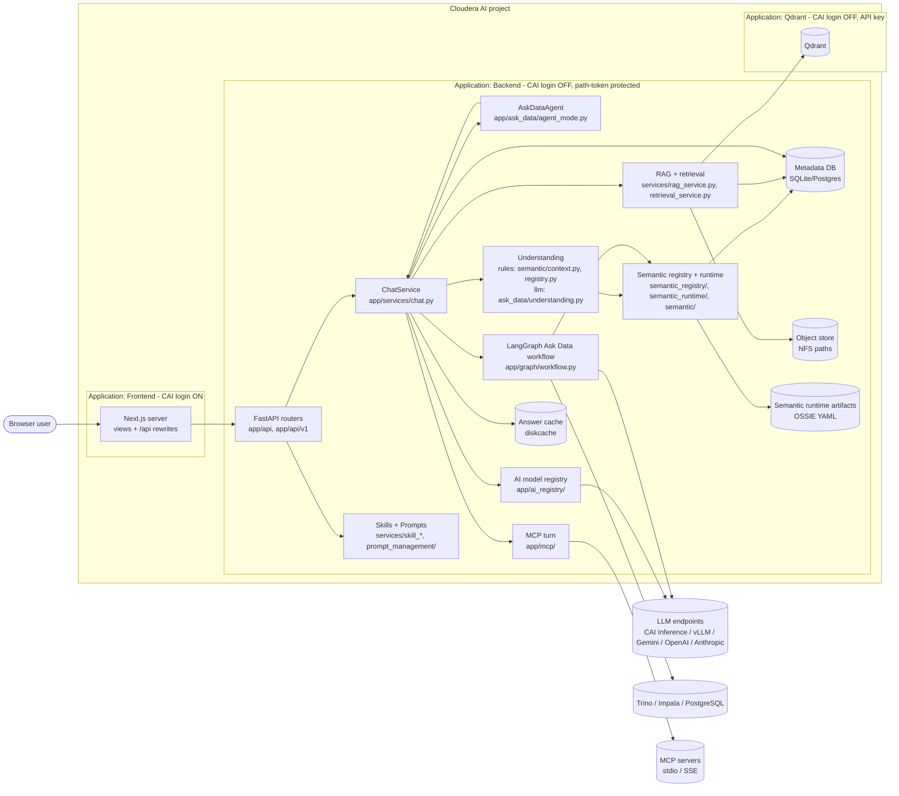
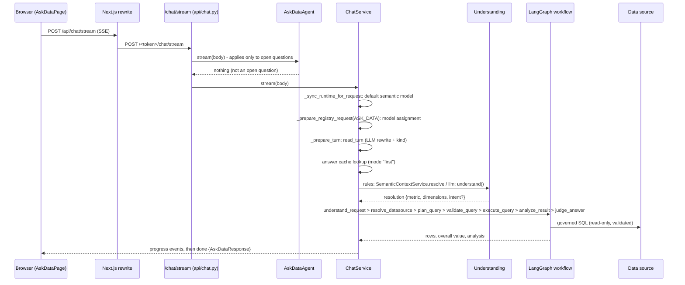

# Anywhere AI Studio: as-is architecture

**Purpose.** An evidence-based description of the system as it exists, for an architecture review that will design new layers
(agent harness and runtime, semantic intelligence, business ontology, modeled and learned knowledge, tool governance, agent
observability). It describes what is there, not what should be. It makes no design decisions.

**Baseline.** Repository `cloudera-ai-studio`, branch `main`, commit `478b1b1` (2026-11-13). Backend `backend/`, frontend
`frontend/`, Cloudera AI packaging `deployment/`, `scripts/amp/`, `.project-metadata.yaml`.

**Method.** Code was read, not inferred from file names or other documents. Claims were cross-checked where they carry risk
(schema creation, secret resolution, test isolation, TypeScript errors). Three parallel read-only inspections covered the
frontend, the backend platform, and knowledge/tools/model routing; the Ask Data, semantic and agent paths were traced directly.

**Status labels used throughout**

| Label | Meaning |
|---|---|
| **Verified (live)** | Observed working in a running Cloudera AI deployment (judge runs against the deployed Backend, 2026-11-12) |
| **Verified (tests)** | Covered by tests that actually execute in the default test run |
| **Implemented, not verified** | Code path exists and was traced; no executing test or live evidence |
| **Partial / experimental** | Works in a narrow form, or parts are unused or unwired |
| **Planned, not implemented** | Referenced (API client method, config, capability) but no working path |
| **Absent** | Searched for and not found |
| **Unknown** | Could not be determined from the code |

---

## 1. Executive summary

Anywhere AI Studio is a three-tier web application packaged as a Cloudera AI AMP: a Next.js frontend, a FastAPI backend, and a
Qdrant vector store, each a Cloudera AI Application. Its core capability is **governed natural-language analytics ("Ask Data")
over a published semantic model** (metrics, dimensions, entities stored in the platform database and compiled into an OSSIE
YAML artifact), answered with SQL the backend compiles itself and runs read-only on Trino, Impala or PostgreSQL. Around it sit
document question answering (RAG over Qdrant), a single-call MCP tool path, versioned prompts and skills, an AI model registry
with per-capability assignments, a usage ledger, and a semantic-layer authoring UI.

There is one real multi-step agent: **Ask Data agent mode**, which plans 2-4 governed data steps (plus an optional document
step), runs each through the normal pipeline, and writes one report. Question understanding has two interchangeable paths:
a rule-based matcher (default) and a language-model reader that returns a checked, structured intent (`ASK_DATA_UNDERSTANDING=llm`).

The system is single-tenant in practice (one default workspace and project), has **no user authentication or authorization
inside the application**, no audit log, no tracing, and integration tests that never run in the default test setup.

## 2. Technology stack

| Layer | Technology | Evidence |
|---|---|---|
| Frontend | Next.js 15 (App Router), React 19, TypeScript 5.8 strict, Tailwind 3.4, Redux Toolkit (one slice), Recharts 3, jsPDF + html2canvas, custom SVG map | `frontend/package.json`, `frontend/app/*`, `frontend/src/store/` |
| Frontend serving | Node server (`next start`), server-side rewrites `/api/*` to the Backend | `frontend/next.config.mjs`, `deployment/cai/launchers/studio-frontend/app.py` |
| Backend | Python 3.10, FastAPI + uvicorn (1 worker), Pydantic v2 / pydantic-settings, SQLAlchemy 2, LangGraph (Ask Data workflow), sqlglot (SQL parsing and safety), httpx | `backend/requirements.txt`, `backend/app/main.py`, `backend/app/graph/workflow.py` |
| Metadata store | SQLite on the project filesystem in Cloudera AI; PostgreSQL supported | `deployment/cai/manifests/applications.yaml`, `backend/app/db/metadata_db.py` |
| Vector store | Qdrant (qdrant-client 1.12.1), one global collection | `backend/app/vectors/store.py` |
| Embeddings / rerank | sentence-transformers `BAAI/bge-m3`; optional cross-encoder `BAAI/bge-reranker-v2-m3` | `backend/app/embeddings/provider.py`, `backend/app/rerank/provider.py` |
| Document parsing | Docling, with pypdf / python-docx / openpyxl fallbacks | `backend/app/documents/parser.py` |
| LLM access | OpenAI-compatible HTTP (vLLM, Cloudera AI Inference), Gemini (google-genai), OpenAI, Anthropic (registry only); structured JSON calls only | `backend/app/llm/providers.py`, `backend/app/ai_registry/runtime_llm.py` |
| Data sources | Trino, Impala, PostgreSQL connectors; DuckDB for local/legacy | `backend/app/connectors/*` |
| Tools | MCP Python SDK (stdio, SSE) | `backend/app/mcp/client.py` |
| Answer cache | diskcache (SQLite file under project storage) | `backend/app/ask_data/answer_cache.py` |
| Packaging | Cloudera AI AMP: 3 jobs, 3-4 Applications | `.project-metadata.yaml`, `scripts/amp/*.py`, `deployment/cai/*` |

## 3. Logical architecture

## 4. Deployment on Cloudera AI

| Element | What it does | Evidence | Status |
|---|---|---|---|
| Job "Install tools and dependencies" | Idempotent steps: data folders, Node.js, backend virtualenv, Qdrant binary, bge-m3 model, `npm ci`; optional reranker and vLLM | `scripts/amp/setup.py` | Verified (live) |
| Job "Deploy applications" | Cloudera AI API v2: create/update/restart Applications from `applications.yaml`, forward env vars, derive secrets, build frontend | `scripts/amp/deploy.py` (`build_plan`, `with_studio_secrets`, `apply_update`) | Verified (live) |
| Job "Update from GitHub" | Fast-forward `git pull`, `pip install` only when requirements changed, then redeploy | `scripts/amp/update.py` | Verified (live) |
| Application Backend | uvicorn on 127.0.0.1, 1 worker, `bypass_authentication: true`, health `/health` | `deployment/cai/launchers/studio-backend/app.py`, `deployment/cai/manifests/applications.yaml` | Verified (live) |
| Application Frontend | `next start`, keeps the Cloudera AI login, reaches the Backend through `BACKEND_API_URL=<backend>/<STUDIO_API_TOKEN>` | `deployment/cai/launchers/studio-frontend/app.py`, `deployment/cai/amp_defaults.py` | Verified (live) |
| Application Qdrant | 4 CPU / 8 GB, `QDRANT__SERVICE__API_KEY` | `deployment/cai/launchers/studio-qdrant/app.py` | Verified (live) |
| Application vLLM (optional) | GPU model server, enabled by `ENABLE_VLLM` | `deployment/cai/manifests/applications.yaml` | Implemented, not verified |
| Env forwarding | Per-app `forward_env` plus `AMP_FORWARD_ENV` (Backend only) | `scripts/amp/deploy.py` `build_plan` | Verified (live) |
| Schema creation in Cloudera AI | `Base.metadata.create_all()` at startup; the launcher never runs Alembic (13 revisions exist in `backend/alembic/versions/`) | `backend/app/stores/factory.py:78`, `deployment/cai/launchers/studio-backend/app.py:34` | Verified (code); see risk R3 |

## 5. End-to-end request flows

### 5.1 Ask Data question (UI path)

Evidence: `backend/app/api/chat.py` (`chat_stream`), `backend/app/services/chat.py` (`stream`, `_prepare_turn`,
`_understand_question`, `_sync_runtime_for_request`, `_stream_ossie_workflow`), `backend/app/graph/workflow.py` (7 nodes,
`build_workflow`), `frontend/src/lib/askDataInflightStream.ts`. Status: **Verified (live)** for the fuel-distribution sample
(judge 16/16 on the rehearsed conversation and 16/16 on paraphrases with `llm`, 2026-11-12, through `/chat`; the judge now uses
`/chat/stream`, commit `478b1b1`, not yet run live).

### 5.2 Other flows

| Flow | Path | Status |
|---|---|---|
| Open question (why, what to do, overview) | `AskDataAgent.stream`: read conversation, load default model, `plan_steps` (LLM, max 5 steps) with `fallback_steps` and headline-metric rules, each data step = `ChatService.run` pinned to a metric, optional knowledge step (RAG), `agent_report.md` report | Verified (live, 4 agent questions in judge) |
| Document question (mode `rag`) | `ChatService._stream_rag` > `rag_chat.stream_rag_turn` > `RAGService.rag_answer` > `RetrievalService.retrieve` (embed, Qdrant search, rerank, context) > LLM > validated citations | Implemented, not verified (DB-backed tests skip) |
| MCP tool (mode `mcp`, from an `@` context chip) | `ChatService._run_mcp` > `invoke_mcp_server`: initialize, list tools, `plan_tool_call` (LLM), argument filtering, one `call_tool`, `narrate_result` | Verified (tests, real stdio server in `test_mcp_credit_risk_server.py`) |
| Skill execution | `POST /api/v1/skills/{id}/execute` > `SkillExecutionService.execute`: one dispatch to Ask Data, RAG or one structured LLM call; not reachable from chat | Partial / experimental |
| Semantic model publish | Semantic API: draft version > entities/dimensions/metrics/terms > validate > `publish-to-ask-data` > `OssieRuntimeAdapter.generate_artifact` > deployment artifact > runtime activation | Verified (live, scripted through `scripts/semantic_api.py`) |

## 6. Components and responsibilities

### 6.1 Backend

| Module | Responsibility | Key symbols | Status |
|---|---|---|---|
| `app/main.py` | App factory, startup validation, routers, middleware (path token, CORS), lifespan (semantic bootstrap, Qdrant collection, ingestion recovery), `/health`, `/health/ready`, `/version` | `create_app`, `_lifespan` | Verified (tests) |
| `app/services/chat.py` (1747 lines) | Orchestrates every chat turn: model resolution, default semantic model, conversation reading, understanding (rules or llm), answer cache, workflow run/stream, RAG and MCP turns, persistence, usage | `ChatService.run`, `stream`, `_prepare_turn`, `_understand_question`, `use_default_semantic_model`, `_serve_cached`, `_persist_turn` | Verified (tests + live) |
| `app/graph/workflow.py` (1327 lines) | LangGraph pipeline: resolution, datasource routing, plan (governed compile, intent compile, or LLM SQL fallback), validation, execution, analysis (`result_analyst.md`), deterministic review and replan | `build_workflow`, `plan_query`, `analyze_result`, `judge_answer` | Verified (tests + live) |
| `app/graph/judge.py` | **Deterministic** answer gates (not an LLM judge) and replan hints | `deterministic_judge`, `judge_review` | Verified (tests) |
| `app/semantic/context.py`, `registry.py` | Runtime semantic context over the OSSIE artifact: metric resolution (alias scoring), dimension inference, governed SQL compilation (`_compile_registry_governed`, `compile_intent`) | `SemanticContextService`, `OssieRegistry.resolve_metric` | Verified (tests + live) |
| `app/ask_data/understanding.py` | LLM reading of a question into `QueryIntent`, checked against catalog and real values, one self-repair round | `understand`, `check`, `build_catalog`, `dimension_values` | Verified (tests + live) |
| `app/ask_data/agent_mode.py` | Agent mode (plan, refine, run steps, report) | `AskDataAgent`, `plan_steps`, `fallback_steps` | Verified (tests + live) |
| `app/ask_data/*` (rest) | Conversation reading, metric choice, structured @-context resolution, value filters, comparisons and drill-across, period parsing, answer checks, answer cache, datasource routing | `read_turn`, `pick_metric`, `resolve_structured_ask`, `default_semantic_model`, `match_values`, `computed_figures`, `AnswerCache` | Verified (tests) |
| `app/semantic_registry/*`, `services/semantic_*` | Authoring store, validation (structural, source), suggestions from table metadata, OSSIE import, artifact generation, publish orchestration | `SemanticRegistryService`, `OssieRuntimeAdapter`, `SemanticPublishOrchestrationService` | Verified (tests + live) |
| `app/semantic_runtime/*` | Runtime bundles, deployments, storage of artifacts, publish governance (glossary, ambiguities) | `SemanticRuntimeLoader`, `RuntimeContextBundle`, `write_deployment_artifact` | Verified (tests) |
| `app/connectors/*` | Connector registry, adapters (Trino, Impala, Postgres), metadata discovery, read-only SQL guard, secrets via `env://` | `ConnectorRegistryService`, `TrinoConnector`, `assert_connector_readonly_sql` | Verified (tests + live for Trino) |
| `app/ai_registry/*` | Providers, models, capability assignments (project > workspace > env), runtime provider construction | `HybridProviderRegistry`, `RuntimeModelResolver`, `SecretResolver` | Verified (unit tests + live); DB-backed tests skip |
| `app/llm/*` | Provider classes, structured JSON generation with schema fallback and thinking stripping, usage context | `_OpenAICompatibleProvider.generate_structured`, `UsageTracker` | Verified (tests) |
| `app/documents/*`, `jobs/`, `embeddings/`, `vectors/`, `retrieval/`, `rerank/`, `rag/` | Upload, parse, chunk, embed, index, retrieve, rerank, answer with citations | `DocumentService`, `TokenChunker`, `QdrantVectorStore`, `RetrievalService`, `RAGService` | Implemented, not verified (end to end) |
| `app/mcp/*`, `workspace/mcp_settings.py` | MCP server registry (workspace settings), client, one-call planner | `invoke_mcp_server`, `plan_tool_call` | Verified (tests) |
| `app/prompt_management/*`, `services/prompt_service.py` | Versioned prompts with scope; only `ask_data.system`, `rag.*`, instruction keys and skill keys are resolved through it | `PromptResolver`, `resolve_prompt_text` | Partial |
| `app/skills/*`, `services/skill_*` | Versioned skills, 3 built-in tools, single dispatch | `SkillExecutionService`, `ToolRegistry` | Partial / experimental |
| `app/stores/*` | Conversation and usage stores over the metadata DB (legacy file stores as fallback) | `build_conversation_store`, `PostgresConversationStore` (also used for SQLite) | Verified (tests) |
| `app/security/path_token.py` | The only API protection: path-prefix secret | `PathTokenMiddleware` | Verified (tests) |
| `app/platform/readiness.py` | Readiness report (DB, storage, Qdrant, embeddings, reranker, LLM, semantic runtime) | `build_readiness_report` | Verified (tests) |

### 6.2 Frontend

| Area | Responsibility | Evidence | Status |
|---|---|---|---|
| Routes | `/` Ask Data, `/knowledge`, `/semantic-layer` (+ `/model`), `/prompts`, `/skills`, `/connectors` (+ new, `[id]`), `/usage`, `/settings` (tabs: general, models, rag, features, mcp, advanced) | `frontend/app/**/page.tsx` > `frontend/src/views/*` | Verified (tests) |
| API access | `fetch('/api' + path)`, no auth headers; Next rewrites to `BACKEND_API_URL` (which carries the path token, server side) | `frontend/src/lib/api.ts`, `frontend/next.config.mjs` | Verified (tests + live) |
| Streaming | SSE client for `/chat/stream`, module-level in-flight stream that survives page changes | `api.chatStream`, `frontend/src/lib/askDataInflightStream.ts` | Verified (tests) |
| Chat history | Browser `localStorage` only (20 sessions with full rows); current session in `sessionStorage`; server keeps its own turn memory but the UI never reads it | `frontend/src/lib/chatSessions.ts` | Verified (tests) |
| Presentation | Tiers 1-3, presets, audience mode; config merged from `/api/v1/ask-data/presentation-config` | `frontend/src/lib/presentationTier*.ts`, `audienceMode.ts` | Verified (tests) |
| Analysis panel, map, PDF | Report panel (summary, sources, map, table, query), Indonesian province SVG map, client-side PDF | `AnalysisReportPanel.tsx`, `ResultMap.tsx`, `geo.ts`, `chatPdfExport.ts` | Verified (tests); PDF chart capture not exercised under jsdom |
| Model selection | One Redux slice; assigned registry model preferred | `frontend/src/store/modelSelectionSlice.ts` | Verified (tests) |
| Feature gating | Build-time `NEXT_PUBLIC_*` defaults plus server overrides; cosmetic only | `frontend/src/lib/featureOverrides.ts`, `src/config/appConfig.ts` | Verified (tests) |

## 7. APIs and integration contracts

**HTTP surface** (all behind the path token except `/health`): chat (`POST /chat`, `POST /chat/stream`, `DELETE /chat/sessions/{id}`),
`GET /models`, `/usage/*`, and under `/api/v1`: `ask-data`, `semantic` (models, versions, entities, metrics, dimensions,
relationships, terms, validate, publish, runtime deployments), `semantic/models/{id}` quality, `connectors`, `ai` (providers,
models, assignments), `libraries`, `documents`, `retrieval`, `rag`, `prompts`, `skills`, `tools`, `chat/attachments`,
`chat/context-options`, `mcp`, `features`, `environment`, read-only `workspaces` and `projects`. Source: `backend/app/main.py` and
`backend/app/api/**`. Status: Verified (tests).

| Contract | Shape | Evidence |
|---|---|---|
| Chat request | `AskDataRequest{session_id, question, provider, model, mode, library_ids?, rag_document_ids?, context_sources?, understanding?}` | `backend/app/core/models.py` |
| Chat response | `AskDataResponse{status, strategy, answer: AnalysisOutput, data: QueryData, chart_spec, calculation, citations, usage, model_resolution, cached_at, cache_reason, ...}` | `backend/app/core/models.py`, `frontend/src/types/api.ts` |
| Stream | SSE `data:` frames: `{"type":"progress", stage, label, detail}` then `{"type":"done", response}`; 15 s keep-alive comments | `backend/app/api/chat.py`, `frontend/src/lib/api.ts` |
| Semantic artifact | OSSIE YAML: datasets (source, fields with `dimension`, `ai_context.display_name/synonyms`), metrics (ANSI expression, `ai_context.synonyms`, `custom_extensions` REFERENCE `{base_dataset, allowed_dimensions, headline?}`), governance file, golden questions | `backend/app/semantic_registry/runtime_adapter.py`, `backend/app/semantic/registry.py` |
| Secrets | Only `env://NAME` references stored; values read from the process environment at use | `backend/app/ai_registry/secrets.py`, `backend/app/connectors/secrets.py` |
| LLM | Structured JSON only (`generate_structured(messages, schema)`); no free-text streaming, no native tool calling | `backend/app/llm/providers.py` |
| MCP | MCP SDK sessions (stdio, SSE); one tool call per turn | `backend/app/mcp/client.py`, `service.py` |

## 8. Data, storage and session state

| Store | Content | Evidence | Status |
|---|---|---|---|
| Metadata DB (30 ORM classes) | Tenancy (workspace, project with `settings_json`), knowledge (library, document, chunk, attachment), chat (conversation, message), prompts and skills (versioned), semantic authoring (model, version, entity, metric, dimension, relationship, term), semantic validation (runs, issues, test cases), semantic runtime (deployment, state, events), connectors and AI registry (provider, model, assignment, test runs), usage events | `backend/app/db/platform_models.py` | Verified (tests) |
| Schema management | `create_all` at startup; Alembic revisions exist but are not run in Cloudera AI | `backend/app/stores/factory.py`, `backend/alembic/` | Partial (risk R3) |
| Object store | Uploaded files under `DOCUMENT_STORAGE_ROOT`, path traversal rejected | `backend/app/storage/object_store.py` | Verified (tests) |
| Vector index | One Qdrant collection, scoped by payload filters (workspace, project, library or document) and re-checked against chunk rows | `backend/app/vectors/*`, `services/retrieval_service.py` | Implemented, not verified |
| Semantic artifacts | `SEMANTIC_RUNTIME_STORAGE_ROOT/<ws>/<project>/<model>/deployments/...` (OSSIE YAML, golden questions, manifest with checksum) | `backend/app/semantic_runtime/storage.py` | Verified (tests) |
| Answer cache | diskcache, 256 MB; key = question rewritten in full + semantic version + understanding mode + LLM + code commit; modes fallback/first/off | `backend/app/ask_data/answer_cache.py` | Verified (tests + live) |
| In-process caches | Dimension values (10 min), data coverage, connector metadata, runtime bundles | `ask_data/value_filters.py`, `ask_data/answer_context.py`, `connectors/discovery.py`, `semantic_runtime/loader.py` | Implemented |
| Server turn memory | Messages with `session_frame` (last metric, dimensions, period) for follow-ups | `backend/app/stores/postgres_conversation.py`, `ask_data/conversation.py` | Verified (tests + live) |
| Browser state | Sessions and model selection in `localStorage`, current session in `sessionStorage` | `frontend/src/lib/chatSessions.ts` | Verified (tests) |

## 9. Semantic and agent capabilities in detail

**Semantic layer.** Authoring is relational (DB rows per version, DRAFT then published); runtime is a compiled OSSIE artifact
loaded into `OssieRegistry`. Metrics carry an ANSI expression, a base dataset, allowed dimensions and synonyms; dimensions
carry a source column, a data type (time flag), a display name and synonyms; entities map to tables or views; relationships
and glossary terms exist but **runtime joins are refused** (`app/ask_data/validation.py`; cross-table questions need a
published view or drill-across by shared dimension values, `app/ask_data/drill_across.py`). Validation runs structural and
source checks and records runs and issues. A "headline" rank on metrics marks the figures an overview starts with.
Status: Verified (tests + live).

**Question understanding.** Two paths selected by `ASK_DATA_UNDERSTANDING` or per request:
- *rules* (default): alias substring scoring (`OssieRegistry._resolve_semantic_registry_catalog_metric`), LLM metric choice only
  when ambiguous (`ask_data/conversation.py pick_metric`), dimension inference from "per/by/which" phrases
  (`ask_data/intent_satisfaction.py match_dimensions`), value filters and typo matching from real values
  (`ask_data/value_filters.py`), regex period parsing. Verified (tests); scored 9/16 on paraphrased questions live.
- *llm*: one structured call returns `QueryIntent` (metric, breakdown, by-month, filters, period, sort, limit, language) from the
  catalog plus real dimension values; code checks every name and value, sends errors back once, drops what stays invalid with a
  note; SQL is compiled from the governed formula (`SemanticContextService.compile_intent`); "top N by month" runs a ranking query
  first. Verified (tests + live: 16/16 and 16/16).

**Agent.** Ask Data agent mode only (`app/ask_data/agent_mode.py`): routing by regex (`_OPEN_QUESTION`) or the conversation
reader's `analysis` kind; LLM plan (`prompts/agent_planner.md`) with code guards (catalog-only metrics, max 4 data + 1
knowledge step, overview must include headline metrics and a group breakdown); sequential step execution through the normal
pipeline (each step a pinned governed question); refinement after step 1; LLM report (`prompts/agent_report.md`) with
code-computed comparisons; follow-ups settled from metrics actually used. No tool loop, no memory beyond the session frame,
no step parallelism (50-70 s per agent answer live). Verified (tests + live).

**Answer quality controls.** Deterministic review gates and replan (`app/graph/judge.py`), figure check against rows
(`app/ask_data/answer_checks.py`), language detection by marker words (`app/core/language.py`), offline judge harness
(`scripts/judge_answers.py` with answer keys in `samples/*/judge_*.json`), semantic benchmarks endpoint
(`app/ask_data/benchmarks.py`), retrieval evaluation script (`scripts/eval_retrieval.py`). No RAG answer-faithfulness evaluation.

**Prompts.** 16 prompt files in `backend/prompts/`; only `ask_data.system`, `rag.system`, `rag.insufficient_evidence`, the
workspace instruction key and skill prompt keys are overridable from the UI; the rest are read from disk.

## 10. Security boundaries

| Concern | Current state | Evidence | Status |
|---|---|---|---|
| User authentication in the app | None: no login, identity, session cookie, or user-bound data | grep of `backend/app`, `frontend/src` | **Absent** |
| Authorization / roles | None; every caller with API access can change models, connectors, MCP servers, prompts | `backend/app/api/v1/*` | **Absent** |
| Platform login | Cloudera AI login on the Frontend Application only; Backend and Qdrant bypass it | `deployment/cai/manifests/applications.yaml`, `scripts/amp/deploy.py` | Verified (live) |
| Backend protection | Secret path prefix `/<STUDIO_API_TOKEN>/`, HMAC-derived per project; `/health` open | `backend/app/security/path_token.py`, `scripts/amp/deploy.py with_studio_secrets` | Verified (tests) |
| Qdrant protection | API key | `deployment/cai/launchers/studio-qdrant/app.py` | Verified (live) |
| Secrets | `env://NAME` references only; `SecretStr` for LLM keys and tokens; `TRINO_PASSWORD` / `IMPALA_PASSWORD` plain `str`; any env name resolves, including internal ones | `backend/app/ai_registry/secrets.py`, `backend/app/core/config.py`, `backend/app/api/v1/environment.py` | Partial (risk R2) |
| SQL safety | Single read-only statement, function/table/column allow-list from the semantic policy, no runtime joins, forced LIMIT | `backend/app/connectors/sql_safety.py`, `backend/app/ask_data/validation.py` | Verified (tests) |
| Tool governance (MCP) | No approval, allow-list, timeout or RBAC; stdio command editable through the API | `backend/app/mcp/*`, `backend/app/api/v1/mcp.py` | **Absent** (risk R4) |
| Audit log | None (only semantic deployment events and usage rows) | `backend/app/db/platform_models.py` | **Absent** |
| Tenancy enforcement | Every request resolves the default project; some routes take a client `workspace_slug` without checks; usage reads unscoped | `backend/app/api/v1/deps.py`, `backend/app/stores/postgres_usage.py` | Partial |

## 11. Observability

| Signal | Current state | Evidence | Status |
|---|---|---|---|
| Logs | stdlib logging, key=value messages, uvicorn defaults; no structured/JSON logging | ~145 call sites in `backend/app` | Implemented |
| Usage | Tokens and LLM calls per turn, `/usage` summary, events, CSV | `backend/app/llm/usage_context.py`, `backend/app/stores/*_usage.py`, `backend/app/api/usage.py` | Verified (tests) |
| Agent visibility | Progress events per step, a calculation note listing steps, "View process" in the UI | `app/ask_data/agent_mode.py`, `frontend/src/components/ProgressStepsPanel.tsx` | Verified (tests) |
| Health | `/health` liveness, `/health/ready` component readiness | `backend/app/platform/readiness.py` | Verified (tests) |
| Metrics, tracing, LLM traces | None (no OpenTelemetry, Prometheus, trace store) | `backend/requirements.txt` | **Absent** |

## 12. Tests and maturity

| Suite | Facts | Status |
|---|---|---|
| Backend | 127 test files; local run 574 passed, **88 skipped**. `tests/conftest.py` sets `DATABASE_URL=""` before any import, so every DB-backed integration test (RAG pipeline, attachments, prompts, skills, registry precedence, stores) always skips | Unit and replay tests verified; integration not verified |
| Replay harness | Real `ChatService` + LangGraph over DuckDB sample data with a scripted LLM (`tests/replay_support.py`) | Verified (tests) |
| Live answer judge | `scripts/judge_answers.py` + answer keys; fuel sample 16/16 and 16/16 (llm) on 2026-11-12 | Verified (live) |
| Frontend | 83 test files, 378 tests (Vitest + Testing Library, jsdom); no end-to-end tests; no ESLint; **0 TypeScript errors on a clean check** (an incremental build cache reports 47 stale errors in test files) | Verified (tests) |
| CI | No CI workflow found | Absent |

## 13. Limitations and risks

| # | Risk | Evidence | Impact |
|---|---|---|---|
| R1 | No user identity, authorization or audit inside the app; anyone through the Frontend login has full admin control of models, connectors, MCP and data | sections 10, 11 | Blocks multi-user governance and enterprise review |
| R2 | `env://` resolution accepts any environment name, including `STUDIO_API_TOKEN`, `QDRANT_API_KEY`, `CDSW_APIV2_KEY`; a provider pointed at an attacker URL could receive them | `backend/app/ai_registry/secrets.py` | Secret exfiltration path |
| R3 | Schema evolution: Cloudera AI runs `create_all`, never Alembic; new columns do not reach existing SQLite databases | `backend/app/stores/factory.py:78`, launcher | Upgrade failures |
| R4 | MCP tools run without approval, allow-list, timeout or RBAC; stdio commands are configurable via API | `backend/app/mcp/*` | Arbitrary command execution by any API caller |
| R5 | Integration tests never execute; RAG, registry precedence and stores are verified only by unit tests with fakes | `backend/tests/conftest.py` | Regressions undetected |
| R6 | Defaults degrade silently: `EMBEDDING_PROVIDER=mock`, `RERANKER_PROVIDER=none` give meaningless retrieval when misconfigured | `backend/app/core/config.py:190,221` | Silent wrong answers in RAG |
| R7 | Single default project at runtime despite a multi-tenant schema | `backend/app/api/v1/deps.py` | No isolation between teams |
| R8 | One mutable semantic context per process; several published models were mixed across entry points until commit `9ebf91d` | `backend/app/services/chat.py apply_runtime_bundle` | Model confusion if a path skips `_sync_runtime_for_request` |
| R9 | Large orchestration files (`services/chat.py` 1747, `graph/workflow.py` 1327, `structured_context_resolver.py` 1301, frontend views 1000-1500 lines) | line counts | High change risk, coupling |
| R10 | Rule-based understanding (word lists, regex) remains the default path; LLM path non-deterministic between runs | sections 9, 12 | Answer variance; needs the judge as a gate |
| R11 | Agent latency 50-70 s (sequential steps, 6-8 LLM calls) | live judge timings | User experience for open questions |
| R12 | Chat history only in the browser (unencrypted, per browser profile, 20 sessions); not shared or auditable | `frontend/src/lib/chatSessions.ts` | No server-side history product |
| R13 | Citations' page numbers approximate (assigned by chunk index); attachments not bound to a chat session | `backend/app/documents/chunker.py`, `services/chat_attachment_service.py` | Trust in document answers |

## 14. Functionality that must be preserved

1. Governed Ask Data: answers only from published metrics; SQL compiled from the metric formula; read-only validated SQL; no runtime joins; overall value and data coverage with every breakdown.
2. Both understanding paths and their switch (`ASK_DATA_UNDERSTANDING`, per-request `understanding`), and the self-repair contract of the LLM path.
3. Agent mode semantics: steps are ordinary governed questions; reports quote code-computed comparisons; follow-ups continue the shown step.
4. The semantic authoring > validation > publish > artifact > runtime lifecycle and the semantic API used by `scripts/semantic_api.py` and the samples.
5. `AskDataResponse` and SSE event contracts consumed by the frontend; session frames for follow-ups.
6. AI registry precedence (project > workspace > env) and `env://` secret references (never values stored).
7. Answer cache modes and key composition (including the code commit), and the default-model rule for every entry point.
8. Cloudera AI packaging: three jobs, Application manifest, env forwarding, path-token wiring between Frontend and Backend.
9. Judge harness and answer keys as the acceptance gate for answer quality.

## 15. Extension points (observed seams, no decisions)

| Future capability | Existing seam | Evidence |
|---|---|---|
| Agent harness and runtime | `AskDataAgent` (plan > steps > report) and its step contract (`AgentStep`, pinned `ChatContextSource`); `ChatService.run/stream` as the single entry; LangGraph workflow nodes | `app/ask_data/agent_mode.py`, `app/services/chat.py`, `app/graph/workflow.py` |
| Semantic intelligence | `QueryIntent` + `check` + `compile_intent`; catalog builder with real values; metric `headline` and `ai_context` extensions in the OSSIE REFERENCE block | `app/ask_data/understanding.py`, `app/semantic/context.py`, `app/semantic_registry/runtime_adapter.py` |
| Business ontology | Entities, relationships and glossary terms already stored per version; governance file (glossary, ambiguities) published with the artifact; relationships unused at runtime | `app/db/platform_models.py`, `app/semantic_runtime/publish_governance.py` |
| Modeled and learned knowledge | Semantic quality knowledge (`/semantic/models/{id}/knowledge`), golden questions and benchmarks, answer cache, server turn memory, feedback endpoint (`/ask-data/feedback`) | `app/api/v1/semantic_quality.py`, `app/ask_data/benchmarks.py`, `app/api/v1/ask_data.py` |
| Tool execution and governance | MCP client and planner (one call), skills `allowed_tools` and `ToolRegistry`, context-source mixing rules | `app/mcp/*`, `app/skills/tool_registry.py`, `app/chat/context_sources.py` |
| Agent observability | Progress events, calculation notes and checks, usage ledger per request, request ids in logs, `ossie_trace` | `app/services/ossie_trace.py`, `app/llm/usage_context.py`, `app/core/models.py CalculationNote` |
| Identity and policy | `PathTokenMiddleware` as the single middleware seam; `default_project_context` dependency used by every v1 router | `app/security/path_token.py`, `app/api/v1/deps.py` |

## 16. Architectural questions requiring decisions

1. **Identity:** rely on the Cloudera AI user identity (forwarded by the Frontend Application) or introduce application-level auth? Which roles must exist (author, analyst, admin)?
2. **Tenancy:** keep one project per AMP deployment, or make workspace/project a request-level scope with enforcement?
3. **Understanding default:** promote the LLM reader to default and retire the rule matcher, or keep both? What is the acceptance gate (judge thresholds, paraphrase sets)?
4. **Ontology vs semantic model:** extend the OSSIE artifact (entities, relationships, glossary) or introduce a separate ontology store that the semantic model references? Should relationships ever drive runtime joins?
5. **Agent runtime:** grow `AskDataAgent` into a general harness (tool loop, parallel steps, memory) or introduce a separate runtime that calls Ask Data as one tool?
6. **Tool governance:** where do approval, allow-lists, timeouts and audit for MCP and skills live, and who may register a tool?
7. **Observability:** adopt tracing (for example OpenTelemetry) and a trace store for LLM and agent steps, or extend the usage ledger?
8. **Persistence:** SQLite on the project filesystem vs PostgreSQL for multi-user and multi-replica operation; Alembic in the deployment path.
9. **Knowledge:** server-side chat history and learned knowledge (feedback, corrections) as governed assets; who curates them?
10. **Evaluation:** make the judge and paraphrase sets a CI gate, and run integration tests against real DB/Qdrant?
