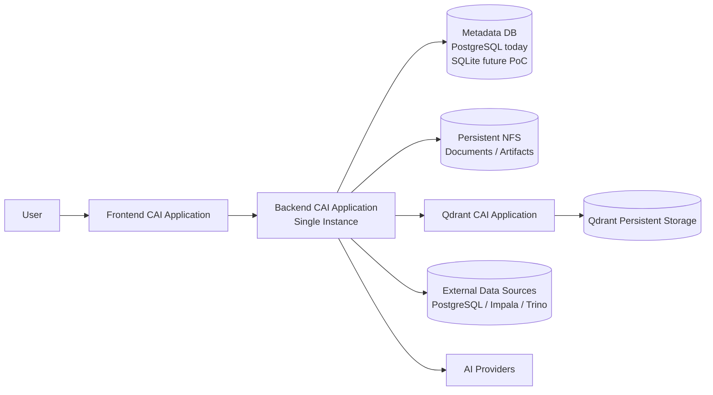

# CAI 3-App Persistence Architecture Audit

**Milestone:** `CAI_3_APP_PERSISTENCE_ARCHITECTURE_AUDIT`  
**Repo:** `cloudera-ai-studio` (standalone)  
**Scope:** Audit and recommendation only — no migration implementation in this milestone.

## Executive summary

Cloudera AI Studio can be **split across three CAI Applications** (Frontend, Backend, Qdrant) using **existing configuration** for remote backend URL, CORS, and `QDRANT_URL`. The **full product today requires PostgreSQL for platform metadata** (`STATE_STORE=postgres` + `DATABASE_URL`). A **fourth PostgreSQL service** (dedicated CAI app or external managed Postgres) is **required for Golden Banking / Knowledge / Semantic / Connectors / AI Registry** unless a substantial metadata portability project is completed.

**PoC target without a PostgreSQL metadata CAI app:** **not supported by current code.**  
**Recommended PoC path with minimal product change:** keep PostgreSQL for metadata (external to the three named apps if needed).  
**Recommended future file-based metadata (after migration):** **SQLite** on NFS, **single uvicorn worker**, not DuckDB.

---

## Target architecture



**Important:** Customer PostgreSQL (Banking connector) is an **external data source**, not application metadata.

---

## Core questions (explicit answers)

| # | Question | Answer |
|---|----------|--------|
| 1 | Exactly 3 CAI apps (FE + BE + Qdrant)? | **Partially yes:** FE/BE/Qdrant separation is feasible. **Full product needs metadata Postgres today** (effectively a 4th persistence dependency). |
| 2 | Dedicated PostgreSQL metadata service required? | **Yes for current codebase** when using full platform features. |
| 3 | Best local file metadata if migrated? | **SQLite** (not DuckDB for ORM OLTP metadata). |
| 4 | File metadata on NFS, single backend? | **Acceptable for PoC only after SQLite migration**, with **one process** and documented NFS risks. **Not safe today** (Postgres is remote). |
| 5 | What must be on NFS? | Document blobs, semantic runtime artifacts; optional unified root via future `CAI_DATA_DIR`. |
| 6 | Qdrant separate from Backend? | **Yes** — client uses `QDRANT_URL` only. |
| 7 | Code/config changes before deploy? | See [Required code changes](#required-code-changes-inventory). Postgres gate removal/portability is **LARGE** for 3-app-no-Postgres goal. |

---

## Current application metadata database

### Evidence trail

| Layer | Location | Behavior |
|-------|----------|----------|
| Settings | `backend/app/core/config.py` | `STATE_STORE` (`sqlite` \| `postgres`), `DATABASE_URL` |
| Dev / Golden | Repo `.env` | `STATE_STORE=postgres`, `DATABASE_URL=postgresql+psycopg://...@127.0.0.1:55432/accelerator` |
| Engine | `backend/app/db/platform_engine.py` | `create_engine(database_url, pool_pre_ping=True)` |
| ORM | `backend/app/db/platform_models.py` | `postgresql.UUID`, `JSONB` on all platform tables |
| Migrations | `backend/alembic/env.py` | Requires `DATABASE_URL`; targets `Base.metadata` |
| Migrations | `backend/alembic/versions/*.py` | PostgreSQL-specific DDL throughout |
| API gate | `backend/app/api/v1/deps.py` | `require_postgres_settings()` → **503** if not postgres + URL |
| Bootstrap | `backend/app/stores/factory.py` | `init_postgres_platform()` → `create_all` + seed when postgres |
| Startup | `backend/app/main.py` lifespan | Calls `init_postgres_platform`; Qdrant ensure is best-effort |

### Current dialect / host / persistence

- **Dialect:** PostgreSQL via SQLAlchemy (`postgresql+psycopg://` in `.env`).
- **Host/path:** Dev uses local Postgres (e.g. `127.0.0.1:55432`, database `accelerator`) — **not** the Banking connector DB.
- **Persistence:** Durable in Postgres; survives backend restart. Files under `DOCUMENT_STORAGE_ROOT` and `SEMANTIC_RUNTIME_STORAGE_ROOT` survive independently.

### Dual-mode nuance (conversation / usage only)

`STATE_STORE` also selects adapters in `build_conversation_store` / `build_usage_store`:

- **Postgres mode:** `PostgresConversationStore` / `PostgresUsageStore` use the **same** `DATABASE_URL` and platform tables `conversations`, `messages`, `usage_events`.
- **Sqlite mode:** Legacy SQLite files `conversation_history.sqlite`, `llm_usage.sqlite` (`backend/app/stores/sqlite_*.py`).

**All `/api/v1/*` platform routes still require Postgres** regardless of this split.

---

## Storage matrix

Legend: **PG** = PostgreSQL platform DB, **FS** = filesystem under configured roots, **QD** = Qdrant, **MEM** = in-process only.

| Component | Current persistence | SQL table/model | FS | Qdrant | Survives restart? | Target CAI location |
|-----------|---------------------|-----------------|----|--------|-------------------|---------------------|
| Chat sessions (platform RAG) | PG | `conversations` | — | — | Yes | Backend metadata DB |
| Chat messages (platform) | PG | `messages` | — | — | Yes | Backend metadata DB |
| Chat sessions (legacy Ask Data API) | PG or SQLite | PG tables or `messages` in `.sqlite` | — | — | Yes | Backend metadata DB / file |
| Knowledge libraries | PG | `libraries` | — | — | Yes | Backend metadata DB |
| Knowledge document metadata | PG | `documents` | — | — | Yes | Backend metadata DB |
| Source file blob | FS | `documents.storage_path` | `DOCUMENT_STORAGE_ROOT` | — | Yes | Backend NFS mount |
| Chunk text | PG | `document_chunks` | — | — | Yes | Backend metadata DB |
| Chunk vectors | QD | point id = `chunk_id` | — | `QDRANT_COLLECTION` | Yes | Qdrant app volume |
| Ingestion recovery counters | PG | `documents.metadata_json.recovery_attempts` | — | — | Yes | Backend metadata DB |
| Temporary chat attachments | PG + FS | `chat_attachments` | same doc store | QD (via linked `document_id`) | Until TTL | Backend DB + NFS; vectors on Qdrant |
| Prompts | PG | `prompts` | — | — | Yes | Backend metadata DB |
| Prompt versions | PG | `prompt_versions` | — | — | Yes | Backend metadata DB |
| Skills | PG | `skills`, `skill_versions` | — | — | Yes | Backend metadata DB |
| Data source definitions | PG | `connectors` | — | — | Yes | Backend metadata DB |
| DS secret references | PG | `connectors.secret_ref` (`env://VAR`) | — | — | Ref yes; secret in env | Backend DB + CAI secrets |
| DS schema/table discovery cache | MEM | — | — | — | No | Backend process |
| Semantic models / versions | PG | `semantic_models`, `semantic_versions` | — | — | Yes | Backend metadata DB |
| Entities / metrics / dimensions / relationships / glossary | PG | `semantic_*` tables | — | — | Yes | Backend metadata DB |
| Semantic validation | PG | `semantic_validation_*` | — | — | Yes | Backend metadata DB |
| Semantic publish / runtime state | PG | `semantic_runtime_*` | — | — | Yes | Backend metadata DB |
| Generated OSSIE / deployment artifacts | FS + PG URI | deployment rows | `SEMANTIC_RUNTIME_STORAGE_ROOT/...` | — | Yes | Backend NFS |
| AI providers / models / assignments | PG | `ai_providers`, `ai_models`, `model_assignments` | — | — | Yes | Backend metadata DB |
| Model test runs | PG | `model_test_runs` | — | — | Yes | Backend metadata DB |
| Usage events | PG or SQLite | `usage_events` or usage `.sqlite` | — | — | Yes | Backend metadata DB |
| Workspaces / projects | PG | `workspaces`, `projects` | — | — | Yes | Backend metadata DB |
| User-facing config (feature flags) | FE build env | — | — | — | Rebuild | Frontend CAI |
| Ask Data legacy DuckDB dataset | FS file | — | `DUCKDB_PATH` | — | Yes | Backend NFS (optional) |
| RAG system prompt default | FS | — | `RAG_SYSTEM_PROMPT_PATH` | — | Yes | Backend image or NFS |
| Legacy OSSIE YAML fallback | FS | — | under `backend/projects/` | — | Yes | Backend bundle |

---

## DuckDB audit

Searched application code, config, and docs (excluding vendored `.venv`).

| Occurrence class | Examples | Classification |
|------------------|----------|----------------|
| `DATA_BACKEND=duckdb`, `DUCKDB_PATH` | `.env`, `config.py`, `deployment/profiles/local.env` | **B** — Ask Data analytical engine |
| `duckdb_governed_backend`, `ask_data/validation.py` | SQL dialect routing | **B** |
| `tempo_gold_local.duckdb` | demo / local profile | **C** — customer/demo analytical file |
| Tests `test_standalone_path_resolution.py` | path resolution | **D** |
| Monorepo backup venv qdrant local persistence | `.venv.monorepo-symlink-backup-*` | **F** — unused vendor |

**Is all Cloudera AI Studio state stored in DuckDB?** **NO.**

**What uses DuckDB?** Legacy **Ask Data** path when `DATA_BACKEND=duckdb` — **not** Knowledge, Semantic, Connectors, or chat platform metadata.

---

## SQLite audit

| Usage | Evidence |
|-------|----------|
| `STATE_STORE=sqlite` | Default in `Settings`; forced in `backend/tests/conftest.py` |
| Conversation / usage files | `conversation_db_path`, `usage_db_path` |
| Factory fallback | Postgres unavailable → SQLite adapters |
| Platform ORM on SQLite | **Not supported** — no models/migrations for full platform on SQLite |
| SQLAlchemy URL `sqlite://` | Not used for platform engine today |

**Portability:** SQLite could host platform metadata **only after** replacing `JSONB`/`UUID` types, rewriting Alembic migrations, removing `require_postgres_settings`, and fixing PostgreSQL-specific queries (e.g. `metadata_json["chunk_count"].astext` in `document_service.py`).

---

## PostgreSQL-specific dependencies

| Item | Location | SQLite impact | DuckDB impact | Migration effort |
|------|----------|---------------|---------------|------------------|
| `postgresql.UUID` columns | `platform_models.py`, all Alembic revisions | Blocking (use String/BLOB or dialect variants) | Blocking | **Large** |
| `JSONB` columns | models + migrations | Use JSON (SQLite) | Limited ORM support | **Large** |
| `'{}'::jsonb` server defaults | Alembic | Rewrite defaults | Rewrite | Medium |
| `metadata_json["chunk_count"].astext` cast | `document_service.py` | Replace JSON extract | Replace | Small per query |
| `pool_pre_ping` + connection pool | `platform_engine.py` | OK on SQLite | OK | None |
| No `ON CONFLICT` / advisory locks in app SQL | grep clean | — | — | — |

---

## SQLAlchemy / Alembic portability (this workload)

| Workload | SQLite (after migration) | DuckDB as metadata | Keep PostgreSQL |
|----------|--------------------------|--------------------|-----------------|
| Session/chat CRUD | Good | Poor fit for SQLAlchemy ORM OLTP | **Proven** |
| Knowledge ingestion status updates | Good with WAL caveats on NFS | Not recommended | **Proven** |
| Prompt/skill/semantic authoring | Good | Poor | **Proven** |
| Alembic migrations | Rewrite all revisions | Rewrite + tooling gap | **Exists** |
| Golden Banking demo | Requires PG today | No | **Current path** |

**Option C (keep PostgreSQL)** matches production reality. **Option A (SQLite)** is the PoC file-DB path **after** a dedicated portability milestone. **Option B (DuckDB metadata)** is **not recommended** for this ORM-centric metadata layer.

---

## Metadata DB recommendation (single backend)

**Assumption:** One backend replica, one uvicorn process (see below).

| Criterion | Recommendation |
|-----------|----------------|
| **Today / Golden Banking unchanged** | **PostgreSQL** via `DATABASE_URL` |
| **Future 3-app PoC without Postgres CAI app** | **SQLite** file under `${CAI_DATA_DIR}/metadata/app.db` **after** METADATA portability work |
| **Avoid** | DuckDB for platform metadata |

**Why PostgreSQL today:** Every v1 API, ORM model, migration, and bootstrap path is PostgreSQL-native; `require_postgres_settings` enforces it.

**Why SQLite for hypothetical file PoC:** Mature SQLAlchemy + Alembic story for embedded OLTP, simpler backup (copy file), aligns with existing conversation SQLite adapters. DuckDB remains appropriate for **analytical** Ask Data, not transactional platform state.

---

## NFS feasibility

Proposed **future** unified root (not implemented):

```text
${CAI_DATA_DIR}/
├── metadata/          # future SQLite or mount point for external PG data dir (if ever local)
├── documents/         # maps to DOCUMENT_STORAGE_ROOT
├── semantic-runtime/  # maps to SEMANTIC_RUNTIME_STORAGE_ROOT
├── attachments/       # optional subdir if split from knowledge store
├── duckdb/            # optional Ask Data file (DUCKDB_PATH)
├── exports/           # regenerable
├── tmp/               # temporary
└── logs/              # optional
```

| Path class | Examples | Classification |
|------------|----------|----------------|
| **MUST PERSIST** | `documents/`, `semantic-runtime/`, Postgres data or future `metadata/app.db`, Qdrant storage | Loss = data loss |
| **REGENERABLE** | Re-embedded vectors (if source docs + chunk rows exist), some OSSIE artifacts from publish | Re-ingest / republish |
| **TEMPORARY** | Processing temp files, attachment TTL blobs | `CHAT_ATTACHMENT_TTL_DAYS` |
| **OPTIONAL** | DuckDB demo file, rerank caches | Feature-dependent |

Current env vars (no `CAI_DATA_DIR` yet): `DOCUMENT_STORAGE_ROOT`, `SEMANTIC_RUNTIME_STORAGE_ROOT`, `DUCKDB_PATH`, `DATABASE_URL` (network), `conversation_db_path` / `usage_db_path` (sqlite mode only).

Post-fix path resolution: `_resolve_backend_relative()` in `config.py` prevents `backend/backend/...` duplication on NFS mounts.

---

## Knowledge storage lifecycle

| Stage | DB | FS | Qdrant | MEM |
|-------|----|----|--------|-----|
| Upload | `documents` row | blob at `storage_path` | — | — |
| Extract/chunk | `document_chunks` | — | — | worker thread |
| Embed/upsert | status in `documents` | — | vectors | — |
| Retrieve | chunk text from PG | — | similarity search | — |
| Startup recovery | `metadata_json`, status | blob must exist | re-embed if requeued | — |

**Must survive backend restart:** PG rows, FS blobs, Qdrant points (for READY docs).  
**Must survive full CAI app restart:** Same + NFS mount durability.  
**Incompatible with NFS-free ephemeral backend disk:** Knowledge source blobs and semantic artifacts.

Documented in `docs/architecture/KNOWLEDGE_INGESTION_LIFECYCLE.md` — compatible with NFS-backed `DOCUMENT_STORAGE_ROOT`.

---

## Chat attachment storage

| Aspect | Detail |
|--------|--------|
| Metadata | `chat_attachments` (Postgres), `expires_at`, link to `documents` when ingested |
| Blob | Shared document object store (`storage_path`) |
| Vectors | Same Qdrant collection; filtered by payload (`source_type=chat_attachment`) |
| TTL | `CHAT_ATTACHMENT_TTL_DAYS` (default 7); `chat_attachment_cleanup.py` |
| Promoted saves | Copied into Knowledge library — not TTL-deleted |
| Restart | Rows + blobs persist until TTL cleanup; **not** long-term archive by default |

---

## Semantic storage (pre–Phase 3)

| Artifact | Source of truth | Regenerable? |
|----------|-----------------|--------------|
| Model/version graph | Postgres `semantic_*` | No |
| Publish / deployment state | `semantic_runtime_deployments`, `semantic_runtime_state` | Partially |
| OSSIE YAML on disk | `SEMANTIC_RUNTIME_STORAGE_ROOT/.../ossie/` | Yes via republish |
| Runtime loader cache | In-memory bundle in `SemanticRuntimeLoader` | Yes on restart |

Metadata DB holds authoritative definitions; NFS holds generated deployment artifacts referenced from DB.

---

## Prompts / skills / model registry

All in Postgres (`prompts`, `prompt_versions`, `skills`, `skill_versions`, `ai_providers`, `ai_models`, `model_assignments`). Secrets stored as **`env://VAR_NAME` references** in DB (`ai_registry/secrets.py`, connector `secret_ref`). Provider keys in `.env` / CAI secrets — **not** plaintext in DB.

Default RAG prompt file on disk is optional override (`RAG_SYSTEM_PROMPT_PATH`); authoritative prompt library is DB.

---

## Data sources

| Persisted | Runtime only |
|-----------|--------------|
| Connector row: type, config JSON, `secret_ref`, status | Live JDBC/Impala/Trino connections |
| Enabled flag, test status fields | `MetadataCache` in `connectors/metadata_cache.py` (TTL `CONNECTOR_METADATA_CACHE_TTL_SECONDS`) |

Customer database **contents** never stored in platform metadata DB.

---

## Secret model

| Secret type | Persisted | Resolution |
|-------------|-----------|------------|
| AI provider keys | `secret_ref` in PG | `env://VAR` via `SecretResolver` |
| Connector credentials | `secret_ref` in PG | Same pattern |
| Qdrant API key | Not in DB | `QDRANT_API_KEY` env |
| Gemini/OpenAI/Qwen defaults | Not in DB | `GEMINI_API_KEY`, etc. |

**Do not** store raw secrets on NFS or in metadata DB plaintext.

---

## Qdrant current architecture

| Topic | Implementation |
|-------|----------------|
| Client | `QdrantVectorStore` in `backend/app/vectors/store.py` |
| URL | `QDRANT_URL` — empty → `build_vector_store()` returns `None` |
| Collection | `QDRANT_COLLECTION` (default `accelerator_chunks`) |
| Point IDs | String form of `chunk_id` UUID |
| Payload | `document_id`, library filters, attachment metadata |
| Startup | Lifespan ensures collection; **exceptions logged, app continues** |
| Readiness | Unhealthy Qdrant → `feature_gaps` (`rag_needs_qdrant`), **`core_ready` can still be true** |
| Localhost | Default in `.env` examples only — not hardcoded in store client |

---

## Qdrant as separate CAI application

| Change class | Assessment |
|--------------|------------|
| Remote URL | **NO CHANGE** — already supported |
| API key / TLS | Config only (`QDRANT_API_KEY`, URL scheme) |
| Network policy | Operational — allow Backend → Qdrant |
| Collection persistence | Qdrant app must mount persistent volume / NFS for vector storage |
| Separate lifecycle | **Supported** — no shared filesystem with Backend required |

---

## Qdrant persistence

Backend does **not** control Qdrant storage path; the Qdrant CAI app must provide durable disk for its data directory. Rebuild vectors possible from Postgres chunk rows + embeddings if vectors lost but docs READY (expensive).

---

## Qdrant failure behavior

| Event | Behavior |
|-------|----------|
| Startup, Qdrant down | Backend **starts**; collection ensure logs exception |
| `validate_startup_config` | Empty `QDRANT_URL` → **warning only** |
| Readiness | `core_ready` false only if Postgres/document/semantic dirs fail — **not** Qdrant alone |
| RAG/Knowledge vector ops | Fail at request time if store unavailable |
| Ingestion recovery | Skipped when `build_vector_store()` is `None` |

**Deployment blocker?** **No** for backend boot; **Yes** for RAG/Knowledge demo until Qdrant is up.

---

## Frontend separation audit

| Item | Status |
|------|--------|
| API proxy | `frontend/next.config.mjs` rewrites to `BACKEND_API_URL` \|\| `http://127.0.0.1:8001` |
| Client-side URL | `NEXT_PUBLIC_BACKEND_URL` in examples |
| Hardcoded `:8001` in TS/TSX | **None found** |
| CORS | Backend `CORS_ORIGINS` must include frontend origin |
| SSE/WebSocket | Not required for core UI paths audited |

**Verdict:** Frontend **can** run as separate CAI app with env configuration.

---

## Backend separation audit

| Dependency | Startup required? |
|------------|-------------------|
| PostgreSQL metadata | **Yes** for full platform (`init_postgres_platform` logged on failure but APIs 503) |
| Document + semantic runtime dirs | **Yes** for `core_ready` |
| Qdrant | **No** (capability) |
| External data sources | **No** |
| AI providers | **No** (degraded LLM) |
| DuckDB Ask Data file | **No** unless using duckdb backend |

---

## Single instance contract

| Setting | Current dev |
|---------|-------------|
| Uvicorn workers | **Default 1** — `scripts/lib/backend-common.sh` has no `--workers` |
| In-process ingestion | `BackgroundTasks` + threads in document runner |
| **Required for future SQLite on NFS** | **`--workers 1` mandatory**; no multi-worker gunicorn |
| **Required for Postgres metadata** | Pool OK; single replica still recommended for background ingestion queue consistency |

---

## File-based DB + NFS risk (single process)

For **hypothetical** SQLite on NFS (PoC only):

- Use SQLite **WAL** with caution on NFS — acceptable for **single writer, one process** PoC with fsync awareness; not HA-safe.
- Avoid multiple uvicorn workers or sidecar processes opening the same DB file.
- Backup: quiesce writes or use SQLite backup API; copy **with** document tree and Qdrant snapshot for consistency.
- Corruption risk rises with concurrent writers — **explicitly out of scope for HA**.

**Safe/acceptable:** PoC demo with documented constraints — **not** production HA.

---

## Restart matrix

| Event | Metadata | Documents | Vectors | Sessions | Semantic | Prompts/skills | User impact |
|-------|----------|-----------|---------|----------|----------|----------------|-------------|
| A. Frontend restart | — | — | — | — | — | — | None if BE up |
| B. Backend restart | PG yes | FS yes | QD yes | PG yes | PG+FS yes | PG yes | Brief outage; ingestion recovery runs |
| C. Qdrant restart | — | — | QD yes | — | — | — | RAG down until QD up |
| D. Full Backend CAI restart | Same as B | Same | Same | Same | Same | Same | Same |
| E. Full Qdrant CAI restart | — | — | Persistent if volume mounted | — | — | — | RAG degraded until healthy |
| F. NFS remount | PG unaffected | **Must remount same paths** | — | — | Artifacts on NFS | — | Missing mount → not_ready |
| G. External DS outage | — | — | — | — | — | — | Ask Data / connectors fail |
| H. AI provider outage | — | — | — | — | — | — | Chat/LLM errors; platform UI may load |

---

## Backup / restore model (PoC)

1. **PostgreSQL:** `pg_dump` / volume snapshot of DB (metadata SoT).  
2. **NFS trees:** `DOCUMENT_STORAGE_ROOT`, `SEMANTIC_RUNTIME_STORAGE_ROOT`.  
3. **Qdrant:** Collection snapshot or volume backup.  
4. **Secrets:** CAI secret store / env export — not from DB plaintext.

**Consistency:** Quiesce ingestion or accept re-run via startup recovery after restore.

---

## Future HA limitation

| Mode | Metadata |
|------|----------|
| **Current target** | Single backend instance; Postgres or future single-file SQLite |
| **Future multi-replica HA** | Requires **external PostgreSQL** (or shared transactional store); file SQLite on NFS **not** suitable |

---

## Required code changes inventory

| ID | File(s) | Purpose | Complexity | Risk |
|----|---------|---------|------------|------|
| CONFIG-001 | `backend/app/core/config.py` | Introduce optional `CAI_DATA_DIR` to derive storage roots | Medium | Low |
| STORAGE-001 | `config.py`, docs | NFS-configurable metadata path (`sqlite:///${CAI_DATA_DIR}/metadata/app.db`) | Medium | Medium |
| METADATA-001 | `platform_models.py`, all Alembic, `deps.py` | Remove postgres-only gate; portable types | **Large** | **High** |
| METADATA-002 | `document_service.py` | Replace JSONB `.astext` sort with portable JSON | Small | Low |
| METADATA-003 | `platform_engine.py` | SQLite engine args (`check_same_thread`, WAL) | Small | Medium |
| QDRANT-001 | Docs / examples only | Document remote `QDRANT_URL` for CAI (code already OK) | Small | Low |
| FRONTEND-001 | Deploy docs | Require `BACKEND_API_URL` + `CORS_ORIGINS` at FE/BE deploy | Small | Low |
| WORKER-001 | Deploy scripts (future) | Enforce `--workers 1` if SQLite metadata | Small | Medium |
| READINESS-001 | Optional | Separate `core_ready` vs RAG in operator docs | Small | Low |
| DUCKDB-001 | None for CAI split | Keep DuckDB optional for Ask Data only | — | — |

---

## Architecture recommendations

### PoC / demo target (3 named CAI apps, no Postgres **metadata** CAI app)

| Goal | Verdict |
|------|---------|
| FE + BE + Qdrant split | **Supported today** with configuration |
| No PostgreSQL metadata service | **Not supported today** — blockers: METADATA-001 |
| Interim PoC with full features | Run PostgreSQL as **external managed DB** (not necessarily a fourth CAI Application, but still a dependency) |
| After METADATA-001 | Backend single process + SQLite on NFS + FE + Qdrant matches target |

### Production-like future

Multiple backend replicas → **external PostgreSQL metadata**, shared document store, Qdrant cluster or managed vector DB, no file-lock metadata.

---

## Mandatory final answers (summary)

See `docs/architecture/CAI_DEPLOYMENT_ENV_CONTRACT.md` for env mapping.

1. **3 apps?** FE/BE/Qdrant yes; **full product also needs metadata Postgres today**.  
2. **Dedicated Postgres for metadata?** **Yes** (current code).  
3. **Current metadata DB?** **PostgreSQL** at `DATABASE_URL`.  
4. **PoC file DB choice?** **PostgreSQL now**; **SQLite after migration** for no-Postgres goal.  
5. **Why?** ORM, migrations, API gates are PostgreSQL-native.  
6. **NFS + file DB safe?** **Only future SQLite, single worker, PoC constraints.**  
7. **Single-process constraint?** **uvicorn workers = 1** if SQLite on NFS.  
8. **In metadata DB?** All platform tables in matrix (workspaces through usage_events).  
9. **Filesystem/NFS?** Document blobs, semantic artifacts, optional DuckDB file, prompt file overrides.  
10. **Qdrant?** Embedding vectors + search payloads for chunks/attachments.  
11. **Qdrant separable today?** **Yes.**  
12. **Qdrant changes?** **Config/ops only (NO CHANGE in code).**  
13. **FE/BE separable today?** **Yes.**  
14. **FE/BE changes?** `BACKEND_API_URL`, `CORS_ORIGINS`, `NEXT_PUBLIC_*` as needed.  
15. **Survives BE restart today?** PG + FS + Qdrant data + recovery requeue.  
16. **After NFS architecture?** Same, if mounts + DB/Qdrant durable.  
17. **CAI blockers?** Postgres metadata dependency; METADATA-001 for 3-app-no-Postgres; NFS mount paths; Qdrant volume for RAG.  
18. **Backend HA later?** External PostgreSQL + shared stores; drop file metadata.

---

## Audit status

**Milestone result:** `CAI_3_APP_PERSISTENCE_ARCHITECTURE_AUDIT_PASS`  

Criteria met: persistence mapped, metadata DB identified, recommendations evidence-based, Qdrant/FE/BE/NFS assessed, change list documented, **no Golden Banking state modified**, **enterprise-ai-poc untouched**.
